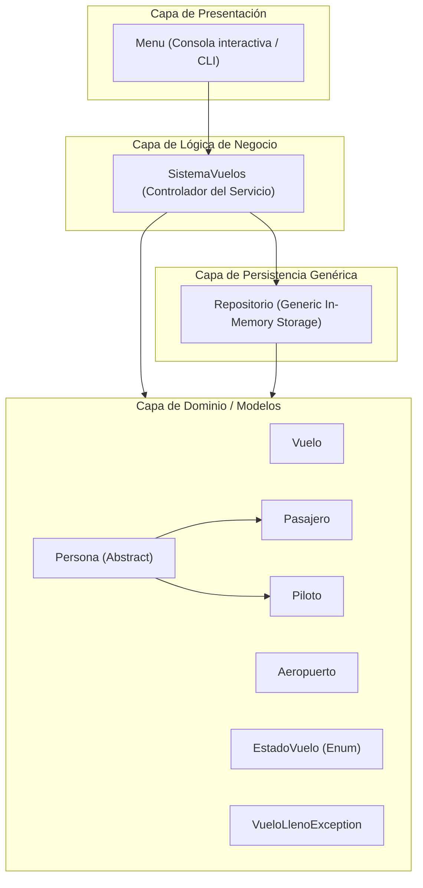
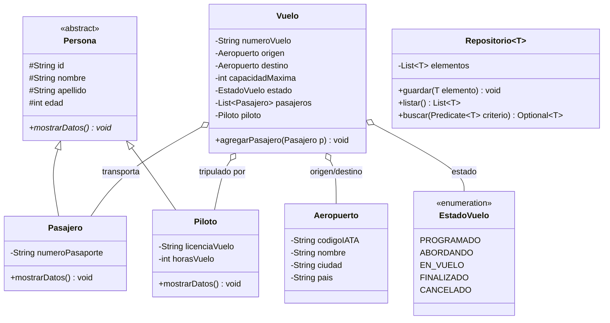

# ✈️ Flight Management System — Sistema Integral de Gestión de Vuelos en Java

<div align="center">

[](https://openjdk.org/)
[](https://maven.apache.org/)
[](https://en.wikipedia.org/wiki/SOLID)
[](LICENSE)

**Sistema modular para la administración integral de aerolíneas, rutas aéreas, control de tripulación y reservas de pasajeros, implementado con arquitectura por capas y patrones de diseño.**

[📦 Repositorio](https://github.com/Sergioandresaparicio/Gestion-de-Vuelos) • [🐛 Reportar Bug](https://github.com/Sergioandresaparicio/Gestion-de-Vuelos/issues) • [✨ Solicitar Feature](https://github.com/Sergioandresaparicio/Gestion-de-Vuelos/pulls)

</div>

---

## 📖 Descripción del Proyecto

**Flight Management System** es una aplicación desarrollada en **Java** diseñada para simular la operación técnica y logística de una red de vuelos comerciales. El sistema garantiza una administración robusta de aeropuertos internacionales, aeronaves, itinerarios de vuelo, asignación de pilotos calificados y emisión de reservas de pasajeros con control estricto de capacidad y sobreventa.

Construido como parte de la formación avanzada en **Campuslands**, el proyecto demuestra el dominio riguroso de los principios de la **Programación Orientada a Objetos (POO)**, patrones de diseño de software (Repository Pattern, DTOs, Enums de estado), genéricos en Java y procesamiento funcional de flujos mediante la **Stream API**.

---

## ✨ Características Principales

* 🏢 **Gestión de Aeropuertos:** Registro, indexación y búsqueda rápida de terminales aéreas por código IATA/identificador internacional.
* 👨‍✈️ **Polimorfismo de Personal y Usuarios:** Modelado de entidades humanas mediante la clase base abstracta `Persona`, especializándose limpiamente en `Pasajero` y `Piloto`.
* 🛫 **Programación y Ciclo de Vida de Vuelos:** Transiciones estrictas de estado controladas mediante enumeraciones (`PROGRAMADO`, `ABORDANDO`, `EN_VUELO`, `FINALIZADO`, `CANCELADO`).
* 🎫 **Control Seguro de Reservas:** Verificación de capacidad máxima en tiempo de ejecución. Disparo de excepciones de dominio personalizadas (`VueloLlenoException`) ante sobrecupos.
* 📊 **Análisis y Estadísticas en Tiempo Real:** 
  * Identificación de destinos únicos disponibles mediante colecciones `Set`.
  * Agrupación y métricas de frecuencia de vuelos por ciudad destino mediante `Map`.
  * Cálculos de porcentaje de ocupación promedio y detección del vuelo de mayor demanda con Java Streams.

---

## 🏗️ Arquitectura de Software y Principios SOLID

El sistema sigue una estricta **arquitectura en capas** que desacopla la presentación de la lógica de dominio y el almacenamiento:



### Diagrama de Clases (UML)



---

### Aplicación Detallada de Principios SOLID

| Principio | Aplicación en el Proyecto |
|---|---|
| **S - Single Responsibility (Responsabilidad Única)** | `Menu.java` gestiona únicamente la entrada/salida de usuario; `SistemaVuelos.java` orquesta las reglas de negocio; `Repositorio.java` se enfoca exclusivamente en almacenar y recuperar entidades. |
| **O - Open/Closed (Abierto/Cerrado)** | La clase genérica `Repositorio<T>` puede gestionar cualquier entidad presente o futura (`Vuelo`, `Aeropuerto`, `Persona`) sin modificar su implementación. |
| **L - Liskov Substitution (Sustitución de Liskov)** | Las subclases `Pasajero` y `Piloto` pueden sustituir a `Persona` en cualquier flujo polimórfico sin alterar el comportamiento esperado del sistema. |
| **I - Interface Segregation (Segregación de Interfaces)** | Las interfaces y métodos están diseñados con un propósito único, evitando forzar a las clases a depender de métodos que no utilizan. |
| **D - Dependency Inversion (Inversión de Dependencias)** | Los servicios operan mediante colecciones parametrizadas y abstracciones genéricas en lugar de implementaciones rígidas. |

---

## 📂 Estructura del Directorio

```text
Gestion-de-Vuelos/
├── pom.xml                                  # Configuración de compilación y dependencias Maven
├── README.md                                # Documentación técnica exhaustiva
├── LICENSE                                  # Licencia de código abierto MIT
├── .gitignore                               # Exclusiones de Git (archivos compilados, target, IDEs)
│
└── GestionVuelos/
    ├── pom.xml                              # POM del módulo de aplicación
    └── src/main/java/com/mycompany/gestionvuelos/
        ├── GestionVuelos.java               # Punto de entrada de la aplicación (Main)
        ├── model/                           # Entidades del dominio y excepciones
        │   ├── Aeropuerto.java              # Información de aeropuertos y terminales
        │   ├── EstadoVuelo.java             # Enum con estados de la máquina de vuelo
        │   ├── Persona.java                 # Clase abstracta base
        │   ├── Pasajero.java                # Subclase con atributos de pasajero
        │   ├── Piloto.java                  # Subclase con credenciales de piloto
        │   ├── Vuelo.java                   # Entidad central del vuelo comercial
        │   └── VueloLlenoException.java     # Excepción de negocio por sobrecupo
        ├── repository/                      # Persistencia desacoplada
        │   └── Repositorio.java             # Repositorio genérico en memoria
        ├── service/                         # Casos de uso y reglas de negocio
        │   └── SistemaVuelos.java           # Servicio de control de vuelos y reportes
        └── util/                            # Utilidades de presentación
            └── Menu.java                    # Interfaz de consola e interacción por teclado
```

---

## 🚀 Instalación y Ejecución

### Prerrequisitos
* **Java Development Kit (JDK):** Versión 17 o superior instalada.
* **Apache Maven:** Versión 3.8+ instalada (o soporte de Maven en tu IDE).

### Compilación y Ejecución por Consola
```bash
# 1. Clonar el repositorio
git clone https://github.com/Sergioandresaparicio/Gestion-de-Vuelos.git
cd Gestion-de-Vuelos/GestionVuelos

# 2. Compilar el proyecto con Maven
mvn clean compile

# 3. Ejecutar la aplicación
mvn exec:java -Dexec.mainClass="com.mycompany.gestionvuelos.GestionVuelos"
```

---

## 🔄 Flujo de Trabajo Git & Conventional Commits

Este proyecto implementa el estándar **Conventional Commits**:
* `feat(vuelo): ✨ añadir validación de capacidad máxima y disparo de VueloLlenoException`
* `docs(readme): 📚 documentar principios SOLID y diagramas de clases UML con Mermaid`
* `refactor(repo): ♻️ parametrizar Repositorio con genéricos de Java`
* `fix(menu): 🐛 corregir validación de entrada numérica en consola`

Cuenta con la rama de desarrollo `develop` para la integración continua de cambios y etiquetas de versión semántica (**SemVer**) `v1.0.0`.

---

## 📄 Licencia

Este proyecto está bajo la Licencia **MIT** — consulta el archivo [LICENSE](LICENSE) para más detalles.

---

## 👨‍💻 Autor

**Sergio Andrés Aparicio Galvis**  
* 💼 LinkedIn: [sergio-andrés-aparicio-galvis](https://linkedin.com/in/sergio-andr%c3%a9s-aparicio-galvis-62b6b8213)  
* 🐙 GitHub: [@Sergioandresaparicio](https://github.com/Sergioandresaparicio)  
* 📧 Correo: [sergioapariciogalvis@gmail.com](mailto:sergioapariciogalvis@gmail.com)
